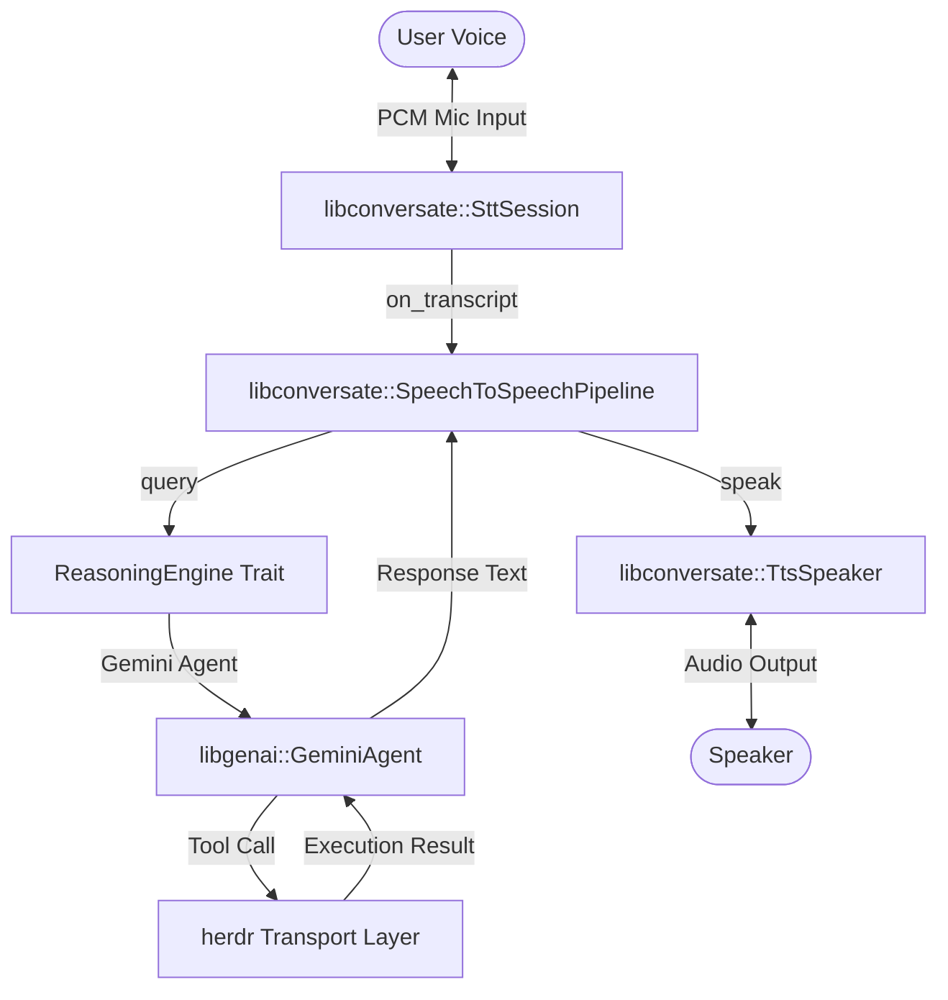

# `handlr` Architecture & Implementation Plan

This document outlines the detailed design and architectural phase for `handlr`, the voice-native command line interface and LLM tool-calling bridge for the `herdr` terminal multiplexer.

---

## 1. System Context & High-Level Architecture

`handlr` coordinates real-time audio capture, speech recognition, LLM-based orchestration, tool execution, and voice synthesis. It leverages three primary components:

*   **`libconversate` (STT & TTS):**
    *   [`SttSession`](file:///Users/tmeade/src/libconversate/crates/libconversate/src/stt.rs#L347): Dictation session wrapping Silero VAD and Whisper/transcribe.cpp backends.
    *   [`TtsSpeaker`](file:///Users/tmeade/src/libconversate/crates/libconversate/src/tts.rs#L108): Handles speech synthesis and chunked playback.
    *   [`SpeechToSpeechPipeline`](file:///Users/tmeade/src/libconversate/crates/libconversate/src/s2s.rs#L55): High-level orchestrator linking capture, transcription, and speaking.
*   **`libgenai` (Reasoning Loop):**
    *   [`GeminiAgent`](file:///Users/tmeade/src/libgenai/src/lib.rs#L69): High-level Gemini interaction wrapper executing prompt injection and tool schemas.
*   **`herdr` Transport (Execution Layer):**
    *   Executes terminal multiplexer commands (via Local Unix Domain Socket or pure-Rust SSH).



---

## 2. Pluggable `ReasoningEngine` Trait Design

To allow clean swapping and layering (e.g., mock engine for testing, local offline models, or complex multi-agent orchestrators), the reasoning layer is decoupled using the `ReasoningEngine` trait.

### A. Trait Definition

```rust
use async_trait::async_trait;
use serde_json::Value;

#[async_trait]
pub trait ReasoningEngine: Send + Sync {
    /// Accepts a natural language transcript, executes any required tool calls
    /// via the provided executor, and returns a natural language voice response.
    async fn process_transcript(
        &self,
        transcript: &str,
        executor: &dyn ToolExecutor,
    ) -> Result<Option<String>, String>;
}

#[async_trait]
pub trait ToolExecutor: Send + Sync {
    /// Execute a tool by name with arguments, returning the output as JSON.
    async fn execute_tool(&self, name: &str, args: &Value) -> Result<Value, String>;
}
```

### B. Concrete Implementations

1.  **`GeminiReasoningEngine` (Default):** Wraps `libgenai::GeminiAgent`. It injects the system prompt from [`AGENTS.md`](file:///Users/tmeade/src/handlr/AGENTS.md), declares the tool schema (`list_panes`, `inspect_pane`, etc.), and processes results via Gemini's function execution flow.
2.  **`MockReasoningEngine` (Testing):** Bypasses LLM network requests. Simulates tool execution outputs or returns deterministic responses to facilitate rapid test automation.
3.  **`RoutingReasoningEngine` (Layered/Fallback):** Routes conversational phrases locally (e.g. "stop", "cancel") while forwarding complex orchestration queries to Gemini.

---

## 3. Alignment with `libconversate` Builder API

`libconversate` automatically configures platforms defaults (like CPAL-based audio output device factories via `CpalAudioSink` and no-op callbacks) when not explicitly provided. Consequently, `handlr` only needs to provide the `SttConfig`, `TtsConfig`, and the core semantic `.with_processor(...)` closure to build a fully-functional pipeline.

### A. Pipeline Instantiation

```rust
let stt_config = SttConfig { ... };
let tts_config = TtsConfig { ... };

let reasoning_engine: Arc<dyn ReasoningEngine> = Arc::new(GeminiReasoningEngine::new(api_key)?);
let tool_executor: Arc<dyn ToolExecutor> = Arc::new(HerdrExecutor::new(transport));

// Setup the S2S pipeline automatically using only `with_processor`
let pipeline = SpeechToSpeechBuilder::new(stt_config, tts_config)
    .with_processor(move |transcript| {
        // Bridge the synchronous processor callback to the async executor
        smol::block_on(async {
            match reasoning_engine.process_transcript(transcript, tool_executor.as_ref()).await {
                Ok(response) => response,
                Err(e) => {
                    log::error!("Reasoning error: {}", e);
                    Some("Sorry, I encountered an error processing that.".to_string())
                }
            }
        })
    })
    .build()?;
```

---

## 4. Coexistence of Processor & STT Callbacks

A common design question is whether to use the central **Processor Loop** or **STT Callbacks**. In `handlr`, they coexist cleanly through clear separation of concerns:

### A. Division of Labor
*   **The Processor Callback:** Owns semantic processing. It intercepts the finalized `on_transcript` string, executes business logic, and yields the final response text to feed to `TtsSpeaker`.
*   **STT Callbacks:** Optional. Own real-time UI/UX feedback and local hardware orchestration. They trigger on low-level pipeline events:
    *   `on_vad_speech(active)`: Triggers immediate UI updates (e.g. changing microphone colors/cues).
    *   `on_partial(text)`: Renders user speech draft on-screen as they speak.
    *   `on_mic_request(active)`: Activates or deactivates microphone physical capture hardware.

### B. Execution Flow & Pipeline Interaction
```
   [ Mic Capture ] -> PCM Audio
         |
         v
   [ SttSession (Whisper/Sherpa) ]
         |
         +---> on_vad_speech(true)  =======> Updates UI Voice Indicator (Optional)
         |
         +---> on_partial("focus")  =======> Renders draft text on terminal (Optional)
         |
         +---> on_transcript("focus on second project")
                     |
                     v
             [ Processor Callback ]
                     | (Bridged to Async Reasoning Engine)
                     v
             [ ReasoningEngine::process_transcript ]
                     |
                     +---> ToolExecutor::execute_tool("focus", target_id)
                     |
                     +---> Returns "Switched focus to second workspace."
                     |
                     v
             [ TtsSpeaker::speak ]
                     |
                     v
             [ Audio Output ]
```

---

## 5. Threading and Concurrency Model

`handlr` maintains high responsiveness by segregating blocking model inference from the asynchronous control loop:

1.  **Async Control Thread:** Runs the asynchronous executor (`smol` or `async-std`) to manage connection I/O with `herdr` and HTTP requests to the Gemini API.
2.  **STT/TTS Inference Worker Threads:** Spawned internally by `libconversate` (`SttSession` / `TtsSpeaker`). They execute CPU/GPU heavy Whisper transcriber tasks and Kokoro audio synthesis, isolating blocking compute from the main application.
3.  **Bridge Execution:** Synchronous callbacks from `libconversate`'s threads are bridged back to the async executor using lightweight futures synchronization primitives (e.g. `smol::block_on`).

---

## 6. Implementation Phases

*   **Phase 1 (Abstractions & Traits):** Implement `ReasoningEngine` and `ToolExecutor` traits. Build mock adapters.
*   **Phase 2 (Transport Integration):** Implement `HerdrExecutor` targeting Unix Domain Socket / SSH connectivity.
*   **Phase 3 (Pipeline Configuration):** Configure `SpeechToSpeechBuilder` integration using automatic sink/callback defaults and verify event propagation.
*   **Phase 4 (Testing):** Validate barge-in functionality and compile schema assertions.
