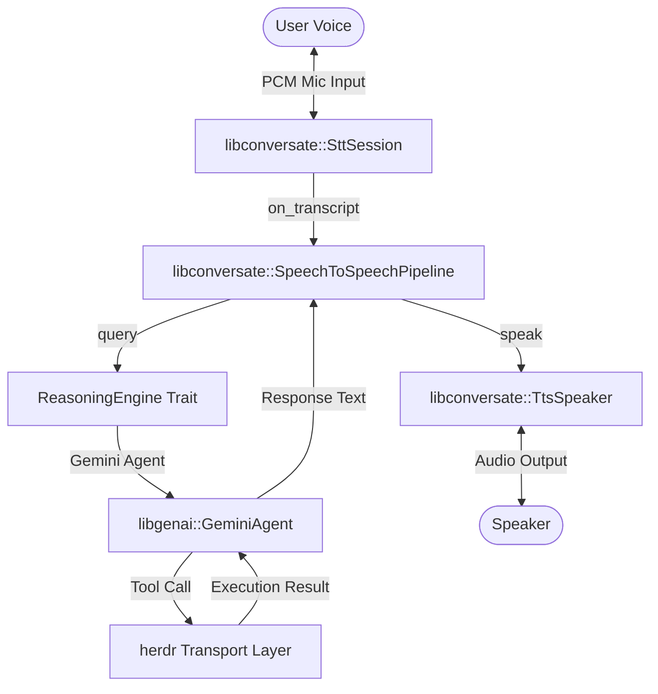

# System architecture and herdr transport

Split from `handlr` Architecture & Implementation Plan. This document outlines the detailed design and architectural phase for `handlr`, the voice-native command line interface and LLM tool-calling bridge for the `herdr` terminal multiplexer.

---

## 1. System Context & High-Level Architecture

`handlr` coordinates real-time audio capture, speech recognition, LLM-based orchestration, tool execution, and voice synthesis. It leverages three primary components:

*   **`libconversate` (STT & TTS):**
    *   [`SttSession`](file:///Users/tmeade/src/libconversate/crates/libconversate/src/stt.rs#L347): Dictation session wrapping Silero VAD and Whisper/transcribe.cpp backends.
    *   [`TtsSpeaker`](file:///Users/tmeade/src/libconversate/crates/libconversate/src/tts.rs#L108): Handles speech synthesis and chunked playback.
    *   [`SpeechToSpeechPipeline`](file:///Users/tmeade/src/libconversate/crates/libconversate/src/s2s.rs#L55): High-level orchestrator linking capture, transcription, and speaking.
*   **`libgenai` (Reasoning Loop):**
    *   [`GeminiAgent`](file:///Users/tmeade/src/libgenai/src/lib.rs#L69): High-level Gemini interaction wrapper executing prompt injection and tool schemas.
*   **`herdr` Transport (Execution Layer):**
    *   Executes terminal multiplexer commands (via Local Unix Domain Socket or pure-Rust SSH).

---

## 5. Threading and Concurrency Model

`handlr` maintains high responsiveness by segregating blocking model inference from the asynchronous control loop:

1.  **Async Control Thread:** Runs the asynchronous executor (`smol` or `async-std`) to manage connection I/O with `herdr` and HTTP requests to the Gemini API.
2.  **STT/TTS Inference Worker Threads:** Spawned internally by `libconversate` (`SttSession` / `TtsSpeaker`). They execute CPU/GPU heavy Whisper transcriber tasks and Kokoro audio synthesis, isolating blocking compute from the main application.
3.  **Bridge Execution:** Synchronous callbacks from `libconversate`'s threads are bridged back to the async executor using lightweight futures synchronization primitives (e.g. `smol::block_on`).

---

## Implementation Phases

*   **Phase 2 (Transport Integration):** Implement `HerdrExecutor` targeting Unix Domain Socket / SSH connectivity.

## Amendment — 2026-10-22 10:47 EDT: retroactive conversion from PLAN.md

This document was split out of the single `PLAN.md` (commit `ecaaa09`,
2026-08-31) when the repository adopted the libcontrols critical rules. The
body above is the original text, unchanged apart from the split; it predates
Rule 1.2 and has no **Done when:** criteria. The date is the original one.

Implementation of the herdr transport (Phase 2) started on 2026-08-31 in `88625e2`, so the
status is set to `In implementation` and the document is now immutable.

## Amendment — 2026-10-22 10:53 EDT: implementation record

Implementation records only; the body above is not changed by this amendment.

**Phase 2 (transport).** Built as the `libherdr` crate: UDS and SSH transports
in `88625e2`; default socket path `~/.config/herdr/herdr.sock` in `590e2b0`
and `e4c90b2`; logging in `7e608cc`; JSON-RPC 2.0 protocol alignment
(`session.snapshot`, `pane.read`, `pane.focus`) in `74d87ea` and `aaa7e05`;
`RunCommand` as `pane.send_input` plus Enter in `1c956b5`; named
`[[transports]]` in `config.toml` with `--transport` in `5559c3b`; held-open
subscription streaming in `f45442b`.

**Departures from the body:**

- The async control loop runs on Tokio (`#[tokio::main]`, `be9362c`), not
  `smol`/`async-std` (§5.1): libgenai's async processor needs a Tokio reactor.
- The executor that `ReasoningEngine` calls is `HerdrToolExecutor` in
  `src/transport.rs`, an adapter over `libherdr`, so `libherdr` and
  `libinfer` stay independent (`aa7ff67`), rather than a `HerdrExecutor`.
- The diagram's tool-call loop is narrower than drawn: the pane state reaches
  the model as RAG context added to each turn (`5af8931`, see plan 02).
- Additions not in this plan: per-agent command permissions and the mechanical
  confirmation gate (`3c5087c` to `be095ab`, documented in AGENTS.md §3), and
  pane watching with spoken agent notifications (`888c64f`, `a7769c9`,
  `a421b2f`).

**Learned.** herdr speaks JSON-RPC 2.0 with its own method names, not the
request shapes first guessed; the snapshot nests the layout one level deep
and agent names sit under `extra`/`agent` (`b444671`).
